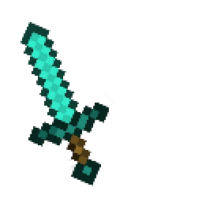

<div align="center">



# Touch-Dz.7

**Troca a bolinha do "Mostrar toques" pela espada de diamante do Minecraft.**

[](https://github.com/DevRaphas/Touch-Dz.7/releases/latest)
[](https://github.com/DevRaphas/Touch-Dz.7/releases)
[](https://www.tiktok.com/@raphaelsantsss)

</div>

---

## Instalação

1. Baixe o `Touch-Dz.7.zip` em [Releases](https://github.com/DevRaphas/Touch-Dz.7/releases/latest).
2. Instale pelo gerenciador de módulos (KernelSU, Magisk, APatch ou AgneSU).
3. Reinicie o celular.
4. Ative **Configurações → Opções do desenvolvedor → Mostrar toques**.

> [!TIP]
> Para liberar as Opções do desenvolvedor, toque 7 vezes em **Versão do sistema** em **Configurações → Sobre o telefone**.

Para remover, desative ou desinstale o módulo e reinicie.

## Requisitos

- Root ou temp root com suporte a módulos
- Android 9 ou superior

| Aparelho | Sistema | Status |
| --- | --- | :---: |
| POCO X7 Pro | HyperOS 3 · Android 16 | ✅ |

Testou em outro aparelho? Conta numa [issue](https://github.com/DevRaphas/Touch-Dz.7/issues).

## Verificação

SHA-256 do `Touch-Dz.7.zip` v4:

```
47f0b0d39fe55b7e51aade2566130a812dbe5150863f4b0a817bcd80711e2265
```

<details>
<summary><b>Como funciona</b></summary>
<br>

O módulo instala um overlay estático (`com.dz7.touch`) em `/product/overlay` que substitui os recursos `pointer_spot_touch_icon` e `pointer_spot_touch_vector_icon` do framework do Android. O código-fonte está em [`src/`](src).

</details>

## Changelog

Veja o [changelog.md](changelog.md).

---

<div align="center">

Feito por **Dz.7** · [TikTok @raphaelsantsss](https://www.tiktok.com/@raphaelsantsss)

<sub>Projeto de fã, sem ligação com a Mojang ou a Microsoft. Minecraft é marca registrada da Mojang Studios.</sub>

</div>
