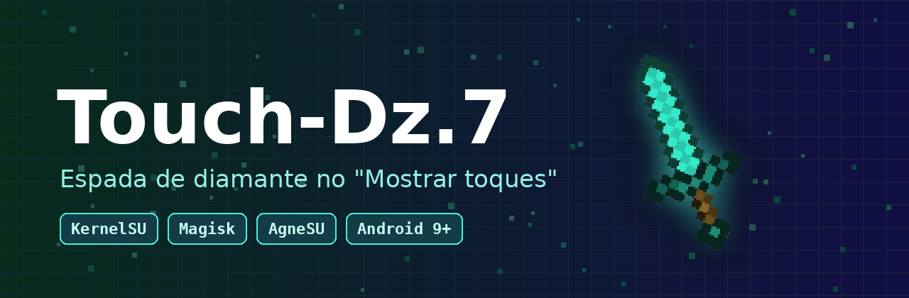
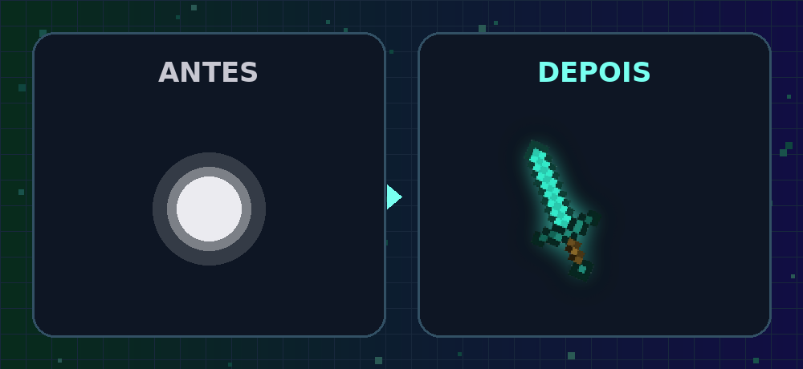
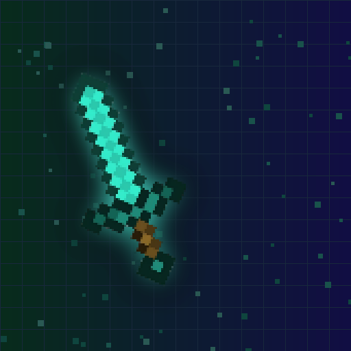

<div align="center">



<br>

[](https://github.com/DevRaphas/Touch-Dz.7/releases/latest)
[](https://github.com/DevRaphas/Touch-Dz.7/releases)
[](https://www.tiktok.com/@raphaelsantsss)

**Troque a bolinha sem graça do "Mostrar toques" pela espada de diamante do Minecraft.**
<br>
Pixel art nítida, sem app rodando em segundo plano e sem gastar bateria.

</div>

---

## ⚔️ Antes e depois

<div align="center">

</div>

## ✨ Destaques

| | |
|---|---|
| 🗡️ **Pixel art de verdade** | Ampliada sem borrar, cada pixel no lugar |
| ⚡ **Zero impacto** | É só um overlay do sistema, sem app e sem serviço rodando |
| 🔄 **Atualização automática** | O gerenciador de módulos avisa quando sai versão nova |
| 🧹 **Fácil de remover** | Desativou o módulo e reiniciou, voltou ao normal |
| 🎥 **Feito para vídeo** | Ideal para gravar tela, tutoriais e gameplays |

## 📥 Instalação

1. Baixe o **`Touch-Dz.7.zip`** em [**Releases**](https://github.com/DevRaphas/Touch-Dz.7/releases/latest)
2. Abra o gerenciador de módulos (**KernelSU**, **Magisk**, **APatch** ou **AgneSU**) e instale o zip
3. Reinicie o celular
4. Vá em **Configurações → Opções do desenvolvedor → Mostrar toques** e ative

> [!TIP]
> Não achou as Opções do desenvolvedor? Vá em **Configurações → Sobre o telefone** e toque 7 vezes em **Versão do sistema** (ou **Número da versão**).

## 📋 Requisitos

- Root ou temp root com suporte a módulos
- Android 9 ou superior

| Aparelho | Sistema | Status |
|---|---|---|
| POCO X7 Pro | HyperOS 3 · Android 16 | ✅ Testado |
| Outros | — | ❔ Deve funcionar, mas não foi testado |

Testou em outro aparelho? Abra uma [issue](https://github.com/DevRaphas/Touch-Dz.7/issues) contando se funcionou.

## 🔐 Verificação

Confira se o arquivo é o original pelo SHA-256 da **v4**:

```
47f0b0d39fe55b7e51aade2566130a812dbe5150863f4b0a817bcd80711e2265
```

<details>
<summary><b>🛠️ Como funciona (para os curiosos)</b></summary>
<br>

O módulo instala um overlay estático (`com.dz7.touch`) em `/product/overlay`. Ele substitui os recursos `pointer_spot_touch_icon` e `pointer_spot_touch_vector_icon` do framework do Android, que são a bolinha desenhada pelo "Mostrar toques".

O código-fonte do overlay está em [`src/`](src).

</details>

## 📝 Changelog

Veja o [changelog.md](changelog.md).

---

<div align="center">



### Feito por **Dz.7**

[](https://www.tiktok.com/@raphaelsantsss)

Gostou? Deixa uma ⭐ no repositório!

<sub>Projeto de fã, sem ligação com a Mojang ou a Microsoft. Minecraft é marca registrada da Mojang Studios.</sub>

</div>
